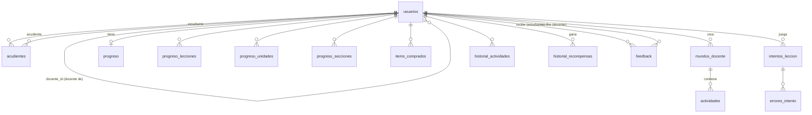

# Modelo de datos (PostgreSQL)

La base de datos es **relacional**: PostgreSQL alojado en **Neon** (plan gratis, 0,5 GB).
Las tablas se definen en código con SQLAlchemy en
[`backend/app/models/tablas.py`](../backend/app/models/tablas.py) y la API las crea solas al
arrancar si no existen ([`backend/app/db.py`](../backend/app/db.py)). Así el modelo vive en
un solo lugar y las pruebas automáticas lo usan tal cual (con SQLite en memoria).

Parte del diccionario de datos relacional del documento de grado (usuarios, actividades,
historial_actividades, resultados, historial_recompensas) y agrega lo necesario para el
camino de lecciones, los mundos del docente, el feedback, la auditoría y el ESP32.

> Antes los datos estaban en Firebase (Firestore). El 19 de octubre de 2026 se copiaron a
> PostgreSQL conservando los mismos identificadores, y la plataforma dejó de usar Firebase.
> Las contraseñas de Firebase no se pueden exportar: a cada adulto se le asigna una nueva.

## Diagrama entidad-relación

## Qué guarda cada tabla

| Tabla | Qué guarda | Equivale en el documento de grado |
|---|---|---|
| `usuarios` | Niños, docentes, padres y admin. Los niños tienen código de acceso, PIN cifrado, docente asignado y la evidencia de la autorización de datos (Ley 1581); los adultos, su correo (único, es su usuario de login), el hash scrypt de su contraseña y los términos aceptados. | `usuarios` |
| `acudientes` | Qué padres/acudientes están vinculados a qué niño (un niño puede tener varios). | — (antes una lista dentro del usuario) |
| `mundos_docente` | Los mundos que crea cada docente. | — |
| `actividades` | Las preguntas: las del temario fijo (id como `animals-1-1`) y las de los mundos del docente (`id_mundo`). | `actividades` |
| `progreso` | Una fila por niño: puntos, nivel, contadores, vidas y perfil de la tienda (avatar, marco, puntos gastados). | `resultados` |
| `progreso_lecciones` | Por niño y lección: aprobada, mejor resultado, intentos, fallos seguidos, última vez. | `resultados` |
| `progreso_unidades` | Por niño y tema: respuestas y aciertos (precisión) y cuándo completó el mundo. | `resultados` |
| `progreso_secciones` | Lecciones nuevas aprobadas desde el último repaso, por apartado. | — |
| `items_comprados` | Lo que el niño compró en la tienda. | — |
| `intentos_leccion` | Cada lección jugada: tema, modo, aciertos, puntos, fecha. | `historial_actividades` |
| `errores_intento` | Cada pregunta que respondió mal en un intento (lo que ve el docente). | — |
| `historial_actividades` | Endpoint antiguo `/api/actividades/completar`. | `historial_actividades` |
| `historial_recompensas` | Cada premio: mundo completado y si la máquina lo entregó. | `historial_recompensas` |
| `feedback` | Comentarios del docente sobre un niño. | — |
| `auditoria` | Solo-inserción: logins, registros, lecciones, compras, errores (RNF-AUD-*). La API nunca edita ni borra filas aquí. | — |
| `intentos_fallidos` | Intentos fallidos seguidos de PIN (por código) o de contraseña (por correo): bloqueo de 10 minutos tras 5 fallos. | — |

Los identificadores públicos (usuarios, actividades, mundos, recompensas, feedback) son
texto de 20 caracteres, como los de Firestore: así se conservaron al migrar y el frontend
no cambió. Los registros que solo se agregan (intentos, errores, auditoría) usan un número
autoincremental. Todas las fechas se guardan con zona horaria (UTC).

Las opciones de una pregunta (`actividades.opciones`) y el detalle de la auditoría
(`auditoria.detalle`) son JSONB: son listas cortas o datos variables que siempre se leen
completos, no se consultan por partes.

## Columnas

### `auditoria`

| Columna | Tipo | Notas |
|---|---|---|
| `id` | INTEGER | PK |
| `tipo` | VARCHAR(40) | obligatoria |
| `actor` | VARCHAR(40) |  |
| `detalle` | JSONB | obligatoria |
| `fecha` | TIMESTAMP WITH TIME ZONE | obligatoria |

### `intentos_fallidos`

| Columna | Tipo | Notas |
|---|---|---|
| `clave` | VARCHAR(270) | PK |
| `fallos` | INTEGER | obligatoria |
| `bloqueado_hasta` | TIMESTAMP WITH TIME ZONE |  |

### `usuarios`

| Columna | Tipo | Notas |
|---|---|---|
| `id_usuario` | VARCHAR(40) | PK |
| `nombre` | VARCHAR(120) | obligatoria |
| `edad` | INTEGER | obligatoria |
| `rol` | VARCHAR(20) | obligatoria |
| `activo` | BOOLEAN | obligatoria |
| `creado_en` | TIMESTAMP WITH TIME ZONE | obligatoria |
| `email` | VARCHAR(254) | única |
| `password_hash` | VARCHAR(200) |  |
| `terminos_version` | VARCHAR(10) |  |
| `terminos_fecha` | TIMESTAMP WITH TIME ZONE |  |
| `device_id_aula` | VARCHAR(60) |  |
| `codigo_acceso` | VARCHAR(10) | única |
| `pin_hash` | VARCHAR(64) |  |
| `docente_id` | VARCHAR(40) | FK → `usuarios.id_usuario` |
| `device_id` | VARCHAR(60) |  |
| `autorizacion_otorgada_por` | VARCHAR(40) | FK → `usuarios.id_usuario` |
| `autorizacion_rol` | VARCHAR(20) |  |
| `autorizacion_fecha` | TIMESTAMP WITH TIME ZONE |  |
| `autorizacion_version` | VARCHAR(10) |  |

### `acudientes`

| Columna | Tipo | Notas |
|---|---|---|
| `id_estudiante` | VARCHAR(40) | PK, FK → `usuarios.id_usuario` |
| `id_acudiente` | VARCHAR(40) | PK, FK → `usuarios.id_usuario` |
| `vinculado_en` | TIMESTAMP WITH TIME ZONE | obligatoria |

### `feedback`

| Columna | Tipo | Notas |
|---|---|---|
| `id_feedback` | VARCHAR(40) | PK |
| `id_estudiante` | VARCHAR(40) | FK → `usuarios.id_usuario`, obligatoria |
| `id_docente` | VARCHAR(40) | FK → `usuarios.id_usuario`, obligatoria |
| `comentario` | TEXT | obligatoria |
| `tipo` | VARCHAR(20) | obligatoria |
| `visible_para_padres` | BOOLEAN | obligatoria |
| `fecha` | TIMESTAMP WITH TIME ZONE | obligatoria |

### `historial_actividades`

| Columna | Tipo | Notas |
|---|---|---|
| `id_historial` | VARCHAR(40) | PK |
| `id_usuario` | VARCHAR(40) | FK → `usuarios.id_usuario`, obligatoria |
| `id_actividad` | VARCHAR(80) | obligatoria |
| `fecha` | TIMESTAMP WITH TIME ZONE | obligatoria |
| `tiempo_empleado` | INTEGER | obligatoria |
| `intentos` | INTEGER | obligatoria |
| `puntaje_obtenido` | INTEGER | obligatoria |

### `historial_recompensas`

| Columna | Tipo | Notas |
|---|---|---|
| `id_historial` | VARCHAR(40) | PK |
| `id_usuario` | VARCHAR(40) | FK → `usuarios.id_usuario`, obligatoria |
| `tipo` | VARCHAR(20) | obligatoria |
| `unidad` | VARCHAR(80) |  |
| `titulo_es` | VARCHAR(80) |  |
| `titulo_en` | VARCHAR(80) |  |
| `emoji` | VARCHAR(16) |  |
| `fecha_entrega` | TIMESTAMP WITH TIME ZONE | obligatoria |
| `puntos_consumidos` | INTEGER | obligatoria |
| `estado` | VARCHAR(20) | obligatoria |
| `device_id` | VARCHAR(60) |  |

### `intentos_leccion`

| Columna | Tipo | Notas |
|---|---|---|
| `id` | INTEGER | PK |
| `id_usuario` | VARCHAR(40) | FK → `usuarios.id_usuario`, obligatoria |
| `unidad` | VARCHAR(80) | obligatoria |
| `seccion` | VARCHAR(20) | obligatoria |
| `titulo_es` | VARCHAR(80) | obligatoria |
| `titulo_en` | VARCHAR(80) | obligatoria |
| `emoji` | VARCHAR(16) |  |
| `leccion` | INTEGER | obligatoria |
| `modo` | VARCHAR(10) | obligatoria |
| `aciertos` | INTEGER | obligatoria |
| `total` | INTEGER | obligatoria |
| `aprobada` | BOOLEAN | obligatoria |
| `puntos` | INTEGER | obligatoria |
| `fecha` | TIMESTAMP WITH TIME ZONE | obligatoria |

### `items_comprados`

| Columna | Tipo | Notas |
|---|---|---|
| `id_usuario` | VARCHAR(40) | PK, FK → `usuarios.id_usuario` |
| `item_id` | VARCHAR(40) | PK |
| `comprado_en` | TIMESTAMP WITH TIME ZONE | obligatoria |

### `mundos_docente`

| Columna | Tipo | Notas |
|---|---|---|
| `id_mundo` | VARCHAR(40) | PK |
| `id_docente` | VARCHAR(40) | FK → `usuarios.id_usuario`, obligatoria |
| `titulo` | VARCHAR(40) | obligatoria |
| `emoji` | VARCHAR(8) | obligatoria |
| `descripcion` | VARCHAR(140) | obligatoria |
| `activo` | BOOLEAN | obligatoria |
| `creado_en` | TIMESTAMP WITH TIME ZONE | obligatoria |

### `progreso`

| Columna | Tipo | Notas |
|---|---|---|
| `id_usuario` | VARCHAR(40) | PK, FK → `usuarios.id_usuario` |
| `puntaje_total` | INTEGER | obligatoria |
| `nivel_logrado` | INTEGER | obligatoria |
| `actividades_completadas` | INTEGER | obligatoria |
| `respuestas_totales` | INTEGER | obligatoria |
| `respuestas_correctas` | INTEGER | obligatoria |
| `vidas_cantidad` | INTEGER |  |
| `vidas_desde` | TIMESTAMP WITH TIME ZONE |  |
| `avatar` | VARCHAR(40) |  |
| `marco` | VARCHAR(40) |  |
| `puntos_gastados` | INTEGER | obligatoria |
| `actualizado_en` | TIMESTAMP WITH TIME ZONE |  |

### `progreso_lecciones`

| Columna | Tipo | Notas |
|---|---|---|
| `id_usuario` | VARCHAR(40) | PK, FK → `usuarios.id_usuario` |
| `unidad` | VARCHAR(80) | PK |
| `leccion` | INTEGER | PK |
| `aprobada` | BOOLEAN | obligatoria |
| `mejor` | INTEGER | obligatoria |
| `total` | INTEGER | obligatoria |
| `intentos` | INTEGER | obligatoria |
| `fallos` | INTEGER | obligatoria |
| `ultima` | TIMESTAMP WITH TIME ZONE |  |

### `progreso_secciones`

| Columna | Tipo | Notas |
|---|---|---|
| `id_usuario` | VARCHAR(40) | PK, FK → `usuarios.id_usuario` |
| `seccion` | VARCHAR(20) | PK |
| `aprobadas_desde_repaso` | INTEGER | obligatoria |

### `progreso_unidades`

| Columna | Tipo | Notas |
|---|---|---|
| `id_usuario` | VARCHAR(40) | PK, FK → `usuarios.id_usuario` |
| `unidad` | VARCHAR(80) | PK |
| `respuestas` | INTEGER | obligatoria |
| `correctas` | INTEGER | obligatoria |
| `completado_en` | TIMESTAMP WITH TIME ZONE |  |

### `actividades`

| Columna | Tipo | Notas |
|---|---|---|
| `id_actividad` | VARCHAR(80) | PK |
| `nombre` | VARCHAR(200) | obligatoria |
| `descripcion` | TEXT | obligatoria |
| `nivel` | INTEGER | obligatoria |
| `tipo` | VARCHAR(20) | obligatoria |
| `puntaje_maximo` | INTEGER | obligatoria |
| `seccion` | VARCHAR(20) |  |
| `unidad` | VARCHAR(80) |  |
| `leccion` | INTEGER |  |
| `orden` | BIGINT |  |
| `pregunta` | TEXT |  |
| `opciones` | JSONB | obligatoria |
| `respuesta_correcta` | TEXT |  |
| `icono` | VARCHAR(16) |  |
| `imagen` | TEXT |  |
| `formato_opciones` | VARCHAR(10) | obligatoria |
| `id_docente` | VARCHAR(40) | FK → `usuarios.id_usuario` |
| `id_mundo` | VARCHAR(40) | FK → `mundos_docente.id_mundo` |
| `activo` | BOOLEAN | obligatoria |
| `creado_en` | TIMESTAMP WITH TIME ZONE | obligatoria |

### `errores_intento`

| Columna | Tipo | Notas |
|---|---|---|
| `id` | INTEGER | PK |
| `id_intento` | INTEGER | FK → `intentos_leccion.id`, obligatoria |
| `id_actividad` | VARCHAR(80) | obligatoria |
| `pregunta` | TEXT |  |
| `icono` | VARCHAR(16) |  |
| `respuesta_dada` | TEXT | obligatoria |
| `respuesta_correcta` | TEXT |  |

## Índices

Además de las llaves primarias y las columnas únicas, hay índices para las consultas que
más se repiten: `actividades (unidad, activo)` para armar una lección,
`intentos_leccion (id_usuario, fecha)` para los últimos intentos de un niño, y las llaves
foráneas que se usan para filtrar (`usuarios.docente_id`, `acudientes.id_acudiente`,
`mundos_docente.id_docente`, `actividades.id_mundo`, `feedback.id_estudiante`, ...).

## Espacio (plan gratis de Neon: 0,5 GB)

- Usuarios y temario: menos de 2 MB.
- Cada lección jugada agrega una fila en `intentos_leccion` (~300–500 bytes con índices):
  100 niños jugando 5 lecciones diarias durante un año escolar son ~50 MB.
- Lo que más pesa son las **imágenes** de las preguntas del docente: se guardan como data
  URL en `actividades.imagen`, hasta ~300 KB cada una. 600 preguntas con imagen pueden
  ocupar hasta ~180 MB. Si el espacio se vuelve un problema, conviene mover las imágenes a
  un almacenamiento de archivos y guardar solo la URL.

## Cola de premios del ESP32

No hay una tabla aparte: la cola de cada máquina son sus filas de `historial_recompensas`
con `estado = 'pendiente'` y su `device_id`. El ESP32 las pide con
`GET /api/recompensas/cola/{device_id}` y, al soltar cada juguete, confirma con
`POST /api/recompensas/{id_historial}/confirmar-entrega`, que cambia el estado a
`entregada` (ver [`esp32/README.md`](../esp32/README.md)).
